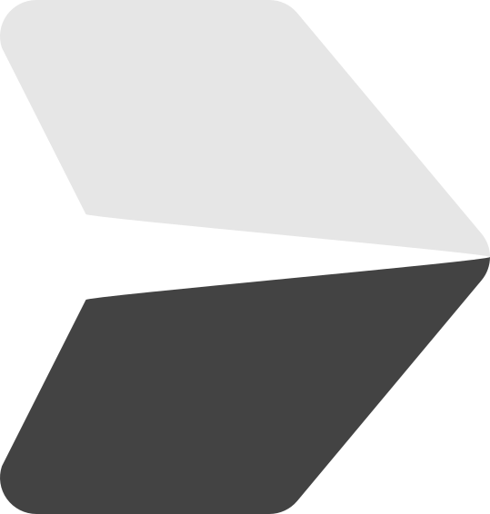
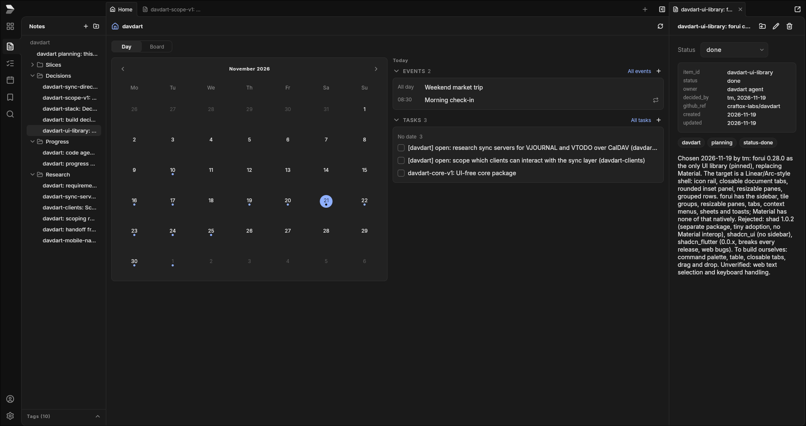

# davdart

Notes, tasks and events over CalDAV, local-first with sync. Notes are stored as iCalendar `VJOURNAL` resources, tasks as `VTODO` and events as `VEVENT`, so any CalDAV server (for example Radicale) holds them and any client can read them. The app is Flutter with forui; the core is a UI-free Dart library.

Work in progress: the layout is still changing.

Status: v0, in development. APIs, note formats and the UI will still change.

## What works today

- A UI-free Dart core: notes, tasks, events, plan items, folders, saved views, a CalDAV client and sync engines for each type.
- A Flutter web app (built on forui 0.28.0): icon rail with Notes, Tasks, Events, Views, Search, Spaces, Account and Settings; a tab strip; a full-page item view with in-place editing; board and list views; a Home page with a Day focus (month calendar with event and task dots, and cards for the selected day's events and tasks, undated tasks listed last) and a Board focus, remembered per Space; an optional mirrored layout; a token-driven theme.
- A small board server that serves the app and proxies CalDAV to the upstream server.
- A CLI for listing, creating, moving and exporting notes.

## Spaces

A Space is a CalDAV collection or a local-only store. Folders and saved views sync as ordinary notes.

Spaces are component-aware. A collection is listed when it holds `VJOURNAL`, `VTODO` or `VEVENT`. One that advertises `VJOURNAL` is a project Space: notes, tasks and events are all available. A collection that does not, such as a calendar made by Fossify Calendar or another `VEVENT`/`VTODO`-only client, shows only the types it advertises or already holds, with no note actions; sync skips the types a collection does not support. The app never creates server collections; new Spaces are local. Removing a Space never deletes server data.

Spaces are discovered at sign-in or with Account > Refresh spaces; collections added on the server later do not appear until you refresh. A fresh install has no Space and starts with a create-a-Space screen.

## Layout

- Desktop (880 px and wider): icon rail, a left panel listing notes, tasks or events for the rail section, and tabs in the main area. Items open in a peek pane or a main tab, depending on the open setting. Right-click menus and drag to move work in the tree, boards and Spaces.
- Narrow and mobile: a top bar with the Space tab, a side menu with the Space chip and a Notes/Tasks/Events/Views filter, a bottom bar, and a grid of open items. Items always open full screen. Swipe right completes a task, with undo; long press opens actions. Open items have an edit/preview toggle and a top-sliding actions sheet, and edits autosave.
- Between 440 and 880 px the board turns into status accordions below 600 px, and Home's calendar collapses to a one-line day stepper.

## Keyboard

- Ctrl/Cmd+K opens a command palette that runs any action and searches the open Space.
- Vim-style navigation across the rail, panels and main pane, a help overlay (`?`) and global chords. Settings > Keyboard turns Vim keys off.
- An optional modal Vim editor (Normal, Insert, Visual) in the note, task and event body fields. It is off on touch devices.

## Dates and timezones

All-day events and date-only due dates are floating dates. Timed values in UTC or with a `TZID` are converted to the viewer's timezone using a bundled timezone database, and recurring events (and tasks) expand in their own zone so daylight saving stays correct. New timed events are written as UTC.

## Planned

Real colours, tables, calendar day cells that show item titles on wide screens, and desktop and phone builds. The planning collection is the source of truth for the roadmap; this list is only a summary.

## Architecture

- Core package (repo root, plain Dart, no Flutter): `Note`, `Task` and `Event` (notes: uid, summary, description, categories, status, timestamps; unmodelled properties such as `ATTACH` are kept so a round trip loses nothing), `PlanItem`, `NoteTree`, `Space`, `SyncEngine` and `TaskSyncEngine`, `CalDavClient` (REPORT, get, put, delete with ETag preconditions; `ConflictException` on 412) and RFC 5545 parsing and serialising for `VJOURNAL`, `VTODO` and `VEVENT`.
- `apps/app`: the Flutter web app. Theme tokens live in `lib/theme/tokens.dart`.
- Logo: `assets/logo/davdart.svg` (the app draws it from the same path data in `apps/app/lib/ui/logo.dart`).
- `apps/web`: a Shelf server for the board, serving the built app at `/app/` and proxying `/dav/` to the CalDAV upstream.

## Getting started

Prerequisites: a Dart SDK (3.5 or newer) and, for the app, a Flutter SDK matching `apps/app/pubspec.yaml`. Local SDK copies under `dart-sdk/` and `flutter-sdk/` are gitignored.

Tests and analysis:

    dart pub get && dart test && dart analyze
    (cd apps/web && dart pub get && dart test && dart analyze)
    (cd apps/app && flutter pub get && flutter test && flutter analyze)

Build and serve the app:

    (cd apps/app && flutter build web --release --base-href /app/)
    (cd apps/web && dart run bin/server.dart 8810)

Set `DAVDART_DAV_UPSTREAM` to the CalDAV server's base URL to enable the `/dav/` proxy the app uses for sync. The server also needs the connection settings below.

CLI: `dart run bin/davdart.dart <command>`. Commands: `list [--status S] [--tag T]`, `board`, `show TEXT`, `add TITLE [BODY]`, `new TITLE [...]`, `set-status MATCH STATUS`, `append MATCH`, `folder TITLE [--under MATCH]`, `move MATCH TARGET|top`, `export DIR`, `rm UID`. Run it without arguments for the full usage line.

## Configuration

The CLI and board server read `url`, `user` and `password` from a key=value file (`~/.config/davdart/credentials`, or the path in `DAVDART_CONFIG`). `DAVDART_URL`, `DAVDART_USER` and `DAVDART_PASSWORD` override each key.

## Note formats

- Folder: a note tagged `kind-folder`. Notes point at their parent by uid; a note whose parent is missing shows at the top level.
- Saved view: a note tagged `kind-view`. The title is the view name; the body is `key: value` lines: `mode` (`board` or `list`), `search`, `tags` (comma separated), `folder` (uid of a folder to scope to). Unknown keys are kept.

Folders and saved views are hidden from boards and lists.

## Project layout

- `lib/`, `bin/davdart.dart`, `test/`: core package and CLI.
- `apps/app/`: Flutter web app.
- `apps/web/`: board server and CalDAV proxy.

## Licence

AGPL-3.0-or-later. See `LICENSE` and `NOTICE`.
